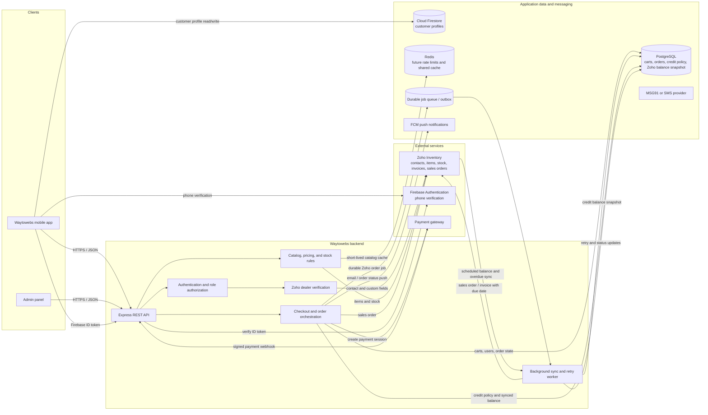

# Waytowebs Mobile App: Architecture and Flows

## Scope and status

The Flutter app uses Firebase Phone Authentication for OTP, Firestore for
customer profiles, and the Express backend for Firebase token verification,
Zoho dealer verification, plumber approval, and role-filtered products.
Firebase fictional test numbers support the interview demo without sending
SMS. Real phone-number SMS requires Firebase billing. PostgreSQL, Redis,
payment processing, order creation, and the admin panel below remain
production-design components; they are not implemented in the proof of concept.

The product catalog and dealer contacts use Zoho Inventory in the India data
center (`/items` and `/contacts`).

## System architecture



**Data boundary:** The backend filters product fields by role. Customer and
plumber responses contain price and an `in_stock` flag, not the stock quantity.
Dealer responses may contain dealer pricing and exact stock. The client must
not be relied on to hide restricted data.

## OTP login

```mermaid
sequenceDiagram
    actor User
    participant App as Mobile app
    participant API as Express API
    participant Firebase as Firebase Auth
    participant Firestore
    participant Zoho as Zoho Inventory

    User->>App: Enter mobile and role
    opt Dealer or plumber
        App->>API: POST /auth/check-eligibility
        API->>API: Check Zoho dealer or approved plumber
        API-->>App: Eligible
    end
    App->>Firebase: Request phone verification
    Firebase-->>User: SMS code (or configured test code)
    User->>App: Enter OTP
    App->>Firebase: Verify phone code
    Firebase-->>App: Firebase user and ID token
    alt Dealer login
        App->>API: POST /auth/firebase-session with ID token
        API->>Firebase: Verify Firebase ID token
        API->>Zoho: Recheck verified dealer contact
        Zoho-->>API: Matching contacts and custom fields
    else Plumber login
        App->>API: POST /auth/firebase-session with ID token
        API->>API: Require admin-approved plumber
    else Customer login
        App->>Firestore: Read users/{firebaseUid}
        alt New customer
            App->>Firestore: Save name, verified phone, role, createdAt
        end
        App->>API: POST /auth/firebase-session with ID token
    end
    API->>Firebase: Verify ID token
    API->>API: Enforce role rules; sign backend JWT
    API-->>App: Backend JWT and authenticated role
```

Firebase's configured fictional test numbers do not send an SMS. Firestore
rules limit customer profile access to its owner and prevent clients from
assigning dealer or plumber roles.

## Customer purchase

```mermaid
sequenceDiagram
    actor Customer
    participant App as Mobile app
    participant API as Express API
    participant Zoho as Zoho Inventory
    participant Pay as Payment gateway
    participant DB as PostgreSQL
    participant Queue as Durable job queue / outbox
    participant Worker as Background worker
    participant Push as FCM

    Customer->>App: Browse products
    App->>API: GET /products with customer JWT
    API->>API: Authorize role; omit exact stock quantity
    API->>Zoho: Read or refresh catalog and availability
    Zoho-->>API: Items, prices, stock
    API-->>App: Products with price and in_stock only
    Customer->>App: Submit cart and delivery details
    App->>API: POST /orders
    API->>API: Revalidate price and availability
    API->>DB: Create pending order
    API->>Pay: Create payment session
    Pay-->>App: Payment authorization flow
    Customer->>Pay: Complete payment
    Pay->>API: Signed server-to-server payment webhook
    API->>API: Verify webhook signature and idempotency
    API->>DB: Record confirmed payment
    API->>Queue: Enqueue Zoho order creation
    API-->>App: Payment received; order processing
    Queue->>Worker: Deliver order job
    Worker->>Zoho: Create sales order
    alt Zoho available
        Zoho-->>Worker: Sales order reference
        Worker->>DB: Mark order confirmed; save Zoho reference
        Worker->>Push: Send order confirmation
    else Zoho unavailable
        Worker->>Queue: Retry with backoff; retain job
        Worker->>DB: Keep order pending Zoho sync
        Worker->>Push: Notify customer that confirmation is pending
    end
```

The order and payment sequence is a proposed design. Implement idempotency and
reconciliation for payment callbacks and Zoho failures before production use.

## Dealer credit checkout

```mermaid
sequenceDiagram
    actor Dealer
    participant App as Mobile app
    participant API as Express API
    participant DB as PostgreSQL
    participant Queue as Durable job queue / outbox
    participant Worker as Background worker
    participant Zoho as Zoho Inventory

    Dealer->>App: Submit cart for credit checkout
    App->>API: POST /orders with dealer JWT and credit payment method
    API->>API: Authorize dealer role; revalidate prices and stock
    API->>DB: Read admin-set credit limit and enabled 30/90-day terms
    API->>DB: Read latest Zoho-synced outstanding and overdue balance
    API->>API: Check term enabled and outstanding + total <= credit limit
    alt Credit approved
        API->>DB: Create pending order with selected term and due date
        API->>Queue: Enqueue idempotent Zoho order job
        API-->>App: Order accepted; Zoho sync pending
        Queue->>Worker: Deliver order job
        Worker->>Zoho: Create sales order / invoice with due date
        alt Zoho available
            Zoho-->>Worker: Document reference
            Worker->>DB: Save reference and mark synced
            Worker->>App: Notify status via FCM
        else Zoho unavailable
            Worker->>Queue: Retry with backoff; retain job
            Worker->>DB: Keep order pending Zoho sync
            Worker->>App: Notify pending status via FCM
        end
    else Credit denied or balance snapshot is stale
        API-->>App: Reject checkout; show actionable error
    end
```

**Credit policy assumption to confirm with the interviewer:** Admin-managed
application data is authoritative for the dealer's credit limit and enabled
30-/90-day terms. Zoho is authoritative for outstanding balances and overdue
invoices; these are synchronized into the application database. At checkout,
the backend checks that the selected term is enabled and that
`outstanding balance + order total <= credit limit`. If the balance snapshot is
stale or unavailable, fail closed and do not approve credit. A durable,
idempotent job retries Zoho document creation if Zoho is temporarily down; the
order remains visibly pending sync until a Zoho reference is recorded.

## Key design rules

- Verify dealer status before creating or sending an OTP; reject missing,
  duplicate, non-dealer, or unverified Zoho contacts.
- Keep OTPs short-lived, single-use, attempt-limited, and rate-limited.
- Authorize every protected endpoint using the role in a validated JWT.
- Enforce role-specific pricing and stock visibility in the backend.
- Revalidate prices, stock, and credit at checkout; do not trust values sent
  by the mobile app.
- Verify payment only from a signed, server-to-server webhook; never trust an
  app callback as proof of payment.
- Treat Zoho/payment timeouts and retries explicitly; use idempotency keys,
  durable jobs, and reconciliation for order creation.
